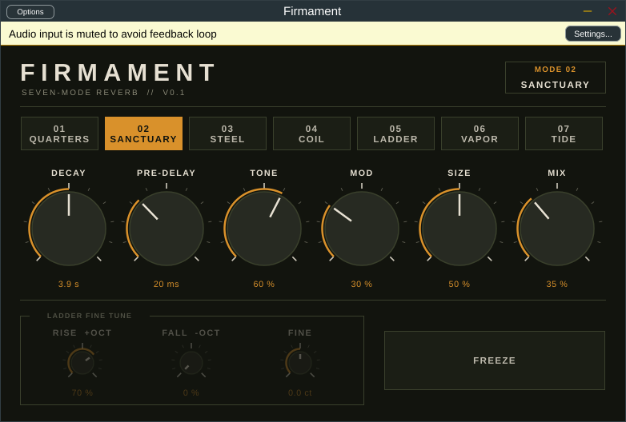

# Firmament

Seven-mode reverb plugin (VST3 + AU, macOS first). Working title.

| # | Mode | What it is | CHARACTER knob |
|---|------|------------|----------------|
| 01 | Quarters | Small room | Size |
| 02 | Sanctuary | Large hall | Size |
| 03 | Steel | Plate | Sheen (top-end tilt) |
| 04 | Coil | Spring | Drip |
| 05 | Ladder | Pitch-climbing tail, octave up and/or down | Climb (regeneration) |
| 06 | Vapor | Ambient cloud | Haze |
| 07 | Tide | Tail swells in after each attack | Rise time |

Shared controls: Decay, Pre-Delay, Tone, Mod, Mix, Character, Freeze.
Ladder fine tune: Rise (+oct level), Fall (-oct level), Fine (+/-50 cents).

## Install (Mac)

Download `Firmament-mac.zip` from Releases, unzip, right-click `Install.command` and choose Open.
Then restart the DAW and rescan plugins.

## Build

    cmake -B build -G Xcode
    cmake --build build --config Release

JUCE 9.0.5 is fetched automatically. Every push to `main` builds the Mac plugin in GitHub Actions.

## Layout

- `Source/dsp/ReverbEngine.h` - the reverb itself, plain C++ with no framework dependency
- `Source/PluginProcessor.*` - parameters and host glue
- `Source/PluginEditor.*` - interface
- `Tests/engine_test.cpp` - offline stability test for every mode

## Licence note

JUCE is dual-licensed (AGPLv3 or the commercial JUCE licence). Check https://juce.com/get-juce before selling.
