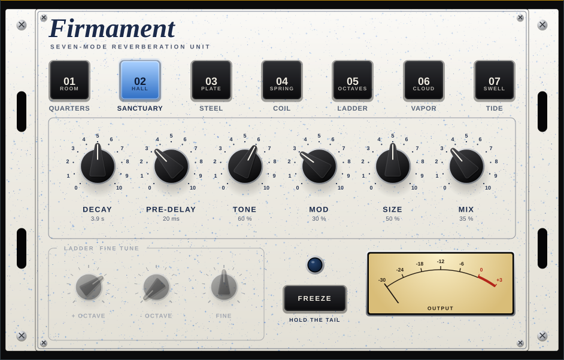

# Firmament

Seven-mode reverb plugin (VST3 + AU, macOS first). Working title.

| # | Mode | What it is | CHARACTER knob |
|---|------|------------|----------------|
| 01 | Quarters | Small room | Size |
| 02 | Sanctuary | Large hall | Size |
| 03 | Steel | Plate | Sheen (top-end tilt) |
| 04 | Coil | Spring | Drip |
| 05 | Ladder | Pitch-climbing tail, octave up and/or down | Climb (regeneration) |
| 06 | Vapor | Ambient cloud | Haze |
| 07 | Tide | Tail swells in after each attack | Rise time |

Shared controls: Decay, Pre-Delay, Tone, Mod, Mix, Character, Freeze.
Ladder fine tune: Rise (+oct level), Fall (-oct level), Fine (+/-50 cents).

# Selah

Church channel strip (working title). Zero added delay, so it works live in the room and on the livestream mix.

1. Pick what is on the channel: Pastor Mic, Lead Vocal, Choir, Acoustic Guitar, Electric Guitar, Bass, Keys, Drums, Full Mix.
2. Turn up only what you need. Every knob all the way down is off.

| Knob | What it does | Under the hood |
|------|--------------|----------------|
| Clean Up | Removes rumble, hiss, harsh S sounds | Low cut, gentle gate, de-esser |
| Warmth | Body and fullness | Console-preamp style low shelf and transformer saturation |
| Clarity | Less mud, more presence | Console-EQ style mud cut, presence and air, tuned per source |
| Even Out | Keeps the level steady | Compressor voiced per source |
| Space | Room sound | Firmament reverb, mode picked per source |
| Volume | Final loudness | Output gain and a safety limiter (TOO LOUD light) |

The ADVANCED switch opens a drawer showing the real numbers behind each knob, plus Reverb Length and the Safety Limiter switch.

## Install (Mac)

Download `Firmament-mac.zip` or `Selah-mac.zip` from Releases, unzip, right-click `Install.command` and choose Open.
Then restart the DAW and rescan plugins.

## Build

    cmake -B build -G Xcode
    cmake --build build --config Release

JUCE 9.0.5 is fetched automatically. Every push to `main` builds the Mac (VST3 + AU) and Windows (VST3) plugins in GitHub Actions.

## Layout

- `Source/dsp/ReverbEngine.h` - the reverb itself, plain C++ with no framework dependency (shared by both plugins)
- `Selah/Source/ChannelEngine.h` - Selah's processing, plain C++
- `Selah/Source/Plugin*` - Selah's parameters and hardware-style interface
- `Shared/ui/` - widgets shared between plugins
- `Source/PluginProcessor.*` - parameters and host glue
- `Source/PluginEditor.*` - interface
- `Tests/engine_test.cpp`, `Tests/selah_test.cpp` - offline stability, level and zero-latency tests

## Licence note

JUCE is dual-licensed (AGPLv3 or the commercial JUCE licence). Check https://juce.com/get-juce before selling.
