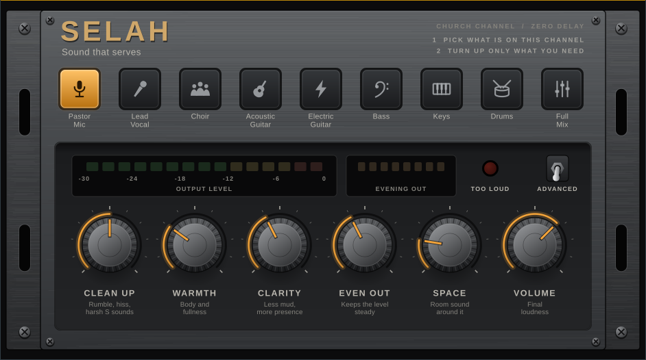
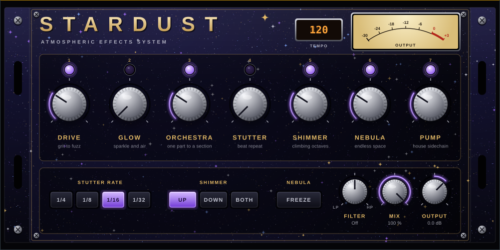

# Firmament

Seven-mode reverb plugin (VST3 + AU, macOS first). Working title.

| # | Mode | What it is | CHARACTER knob |
|---|------|------------|----------------|
| 01 | Quarters | Small room | Size |
| 02 | Sanctuary | Large hall | Size |
| 03 | Steel | Plate | Sheen (top-end tilt) |
| 04 | Coil | Spring | Drip |
| 05 | Ladder | Pitch-climbing tail, octave up and/or down | Climb (regeneration) |
| 06 | Vapor | Ambient cloud | Haze |
| 07 | Tide | Tail swells in after each attack | Rise time |

Shared controls: Decay, Pre-Delay, Tone, Mod, Mix, Character, Freeze.
Ladder fine tune: Rise (+oct level), Fall (-oct level), Fine (+/-50 cents).

# Selah

Church channel strip (working title). Zero added delay, so it works live in the room and on the livestream mix.

1. Pick what is on the channel: Speaker Mic, Lead Vocal, Choir, Acoustic Guitar, Electric Guitar, Bass, Keys, Drums, Full Mix.
2. Turn up only what you need. Every knob all the way down is off.

| Knob | What it does | Under the hood |
|------|--------------|----------------|
| Clean Up | Removes rumble, hiss, harsh S sounds | 18 dB/oct low cut, soft gate with hold, band de-esser that only acts while the S band sticks out |
| Warmth | Body and fullness | Broad low shelf, transformer-style saturation on the low end (third harmonic), a little second harmonic across the band |
| Clarity | Less mud, more presence | Proportional-Q mud cut and presence bells plus an air shelf, frequencies picked per source |
| Even Out | Keeps the level steady | Compressor voiced per source: leveler for speech, fast soft-knee with harmonics for vocals and drums, slow-attack bus glue for the full mix; two-stage release; low end kept out of the detector on bass, drums and mix |
| Space | Room sound | Firmament reverb (16-line network), mode and length per source, filtered send, ducks under speech and lead vocal |
| Volume | Final loudness | Output gain, then a two-stage safety limiter (smooth leveling plus soft clip) that holds -1 dBFS with no look-ahead |

All of it is zero-latency. Bells are matched to the analogue curve near the top of the range, so 10-20 kHz moves keep their shape at 44.1/48 kHz.

`Tests/selah_measure.cpp` prints bench numbers (EQ accuracy, harmonics, compressor curves and timing, de-esser, limiter, reverb levels, CPU). Every build is also checked with pluginval at strictness 8.

Underneath is a graphic EQ: 7, 14 or 21 bands (+/-12 dB each), a switch to place it before or after the channel processing, and a FLAT key.

The ADVANCED switch opens a drawer showing the real numbers behind each knob, plus Reverb Length and the Safety Limiter switch.

# STARDUST

Atmospheric effects for house music and cinematic sound. Seven effects in one unit, zero added delay, locked to your DAW's tempo.

| # | Effect | What it does |
|---|--------|--------------|
| 1 | Drive | Warm grit up to full fuzz, with the fizz tamed as it gets dirtier |
| 2 | Glow | New harmonics from the top end only, plus air |
| 3 | Orchestra | Turns one part into a section: detuned unison voices, an octave below and an octave above that bow in after each note |
| 4 | Stutter | Beat-repeat locked to the tempo (1/4 to 1/32). A little = last beat of the bar, more = beats 2 and 4, full = every beat |
| 5 | Shimmer | Tails that climb an octave up, down or both |
| 6 | Nebula | Huge reverb (about 3 to 24 seconds), FREEZE holds it forever |
| 7 | Pump | House sidechain pump on every beat |

Plus FILTER (left = low-pass, right = high-pass, double-click to centre), MIX and OUTPUT. With every effect at zero it passes audio through untouched. The amber window shows the tempo it is following.

## Install (Mac)

Download `Firmament-mac.zip`, `Selah-mac.zip` or `STARDUST-mac.zip` from Releases, unzip, right-click `Install.command` and choose Open.
Then restart the DAW and rescan plugins.

## Build

    cmake -B build -G Xcode
    cmake --build build --config Release

JUCE 9.0.5 is fetched automatically. Every push to `main` builds the Mac (VST3 + AU) and Windows (VST3) plugins in GitHub Actions.

## Layout

- `Source/dsp/ReverbEngine.h` - the reverb itself, plain C++ with no framework dependency (shared by both plugins)
- `Selah/Source/ChannelEngine.h` - Selah's processing, plain C++
- `Selah/Source/Plugin*` - Selah's parameters and hardware-style interface
- `Stardust/Source/StardustEngine.h` - STARDUST's processing, plain C++
- `Stardust/Source/Plugin*` - STARDUST's parameters and interface
- `Shared/ui/` - widgets shared between plugins
- `Source/PluginProcessor.*` - parameters and host glue
- `Source/PluginEditor.*` - interface
- `Tests/engine_test.cpp`, `Tests/selah_test.cpp` - offline stability, level and zero-latency tests

## Licence note

JUCE is dual-licensed (AGPLv3 or the commercial JUCE licence). Check https://juce.com/get-juce before selling.
